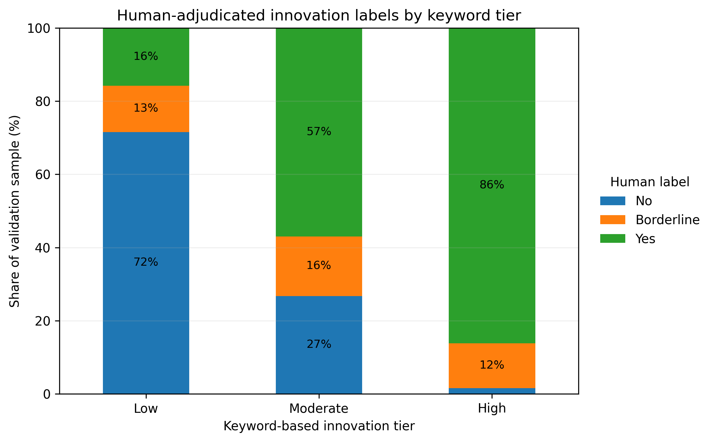
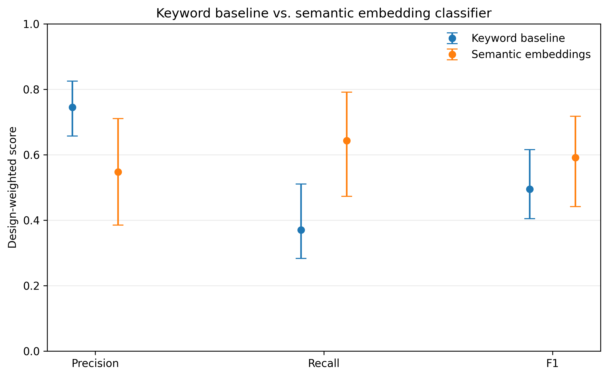
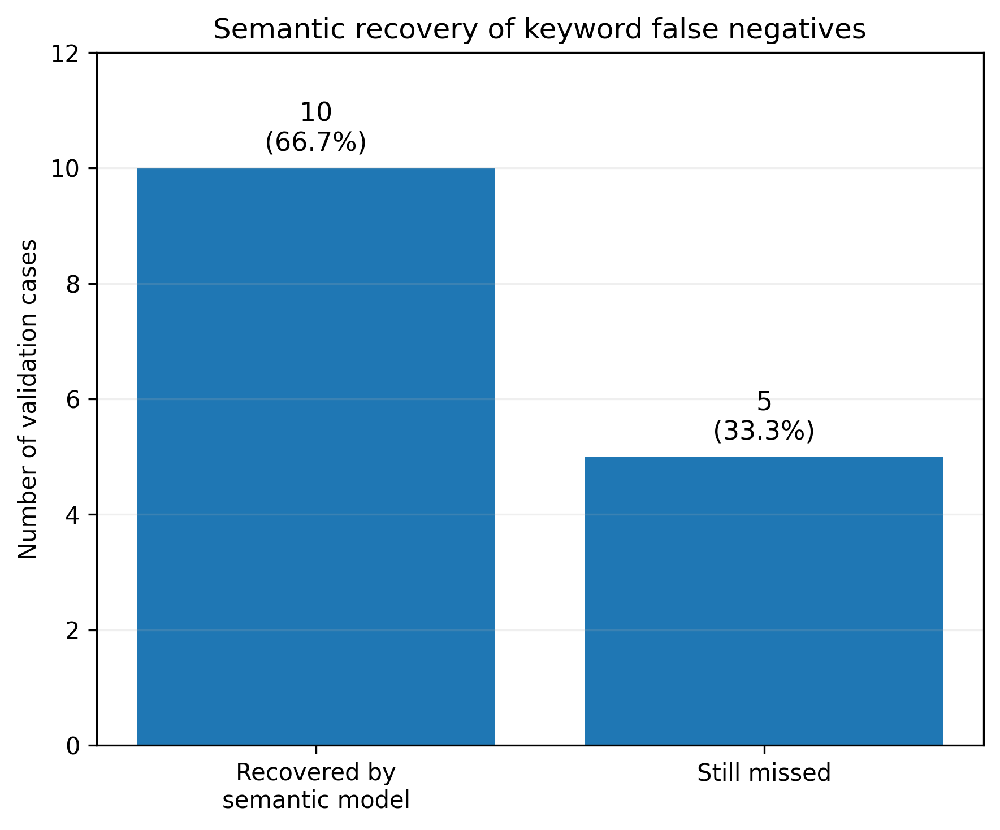

# Evaluating Semantic NLP for Innovation Classification in the World Bank Portfolio

## Overview

This project reproduces and extends one component of the methodology used in the World Bank Policy Research Working Paper *Innovation Patterns in the World Bank Group Portfolio: A Pilot Analysis of IEG Evaluations for Lending Operations* (Agapitova et al., 2026).

The original study applies large-scale text analytics and generative-AI methods to more than 7,500 Independent Evaluation Group (IEG) project evaluations. This independent extension focuses on one narrower question:

> **Can semantic text representations complement keyword-based classification by identifying innovation that is expressed through meaning rather than explicit innovation terminology?**

The analysis follows four steps:

1. reproduce the published innovation classification;
2. construct and adjudicate a stratified validation sample;
3. evaluate the keyword classification against the validation reference;
4. compare it with a semantic embedding classifier using the same reference and sampling design.

The main finding is a clear trade-off: **semantic classification substantially increases recall but reduces precision**. It appears useful as a complementary signal for identifying potentially innovative projects missed by lexical classification, rather than as an unambiguous replacement for the existing approach.

---

## 1. Reproducing the published classification

I first reproduced the relevant innovation-classification pipeline from the World Bank reproducibility package.

The resulting project-level dataset contains **7,574 unique projects**:

| Innovation tier | Projects |
|---|---:|
| Low | 6,600 |
| Moderate | 774 |
| High | 200 |
| **Total** | **7,574** |

For this evaluation:

- **Low** = negative prediction
- **Moderate or High** = positive prediction

The applicable automated tests in the public package passed (**68 tests**). An additional 29 manuscript-comparison tests could not be executed because the manuscript DOCX referenced by those tests was not included in the downloaded reproducibility package.

---

## 2. Validation design

A fixed-seed stratified sample of **246 projects** was drawn to provide sufficient observations from all three innovation tiers.

| Keyword tier | Portfolio N | Validation n |
|---|---:|---:|
| Low | 6,600 | 95 |
| Moderate | 774 | 86 |
| High | 200 | 65 |
| **Total** | **7,574** | **246** |

Because the sample deliberately oversamples Moderate and High projects, inverse-probability sampling weights are used for portfolio-level performance estimates.

Each sampled lesson was assigned one of three reference labels:

- **Yes** — substantive evidence or discussion of innovation
- **No** — no substantive evidence of innovation
- **Borderline** — insufficient evidence for a confident Yes/No classification

The cases were AI-pre-annotated and subsequently human-adjudicated. The labels are therefore treated as a **human-adjudicated validation reference**, rather than independently double-coded ground truth.

Final labels were:

- **120 Yes**
- **92 No**
- **34 Borderline**

The primary analysis excludes Borderline cases. Two sensitivity analyses alternatively classify all Borderline observations as No and as Yes.

---

## 3. Validation of the original tiers

Human assessment shows a strong gradient across the published keyword tiers:

- **15.8%** of sampled Low projects were labelled Yes
- **57.0%** of Moderate projects were labelled Yes
- **86.2%** of High projects were labelled Yes



This suggests that the original tiers contain meaningful information. At the same time, the human-positive cases in the Low tier indicate that some substantive innovation may not accumulate enough lexical signals to move beyond the Low category.

---

## 4. Semantic NLP extension

I used `sentence-transformers/all-MiniLM-L6-v2` to represent project lesson text semantically.

Because many lessons exceed the model context window, long documents were divided into model-compatible chunks. Each chunk was embedded separately and the chunk embeddings were averaged to create one **384-dimensional project representation**.

Among the 212 definite Yes/No validation cases, **77.4% required multiple chunks**, with a median of 3 chunks.

A weighted logistic-regression classifier was then trained on the project embeddings.

Performance was estimated using **five-fold stratified out-of-fold prediction**, ensuring that each evaluated observation was predicted by a model that had not been trained on that observation.

Sampling weights were incorporated in model fitting and in portfolio-level performance estimation.

---

## 5. Results

The primary analysis excludes the 34 Borderline cases.

| Model | Precision | Recall | F1 |
|---|---:|---:|---:|
| **Keyword baseline** | **0.745** | 0.370 | 0.495 |
| **Semantic embeddings** | 0.547 | **0.643** | 0.591 |

These are design-weighted estimates.



Sampling uncertainty was assessed using **5,000 stratified bootstrap replications**.

| Metric | Semantic − Keyword | 95% bootstrap interval |
|---|---:|---:|
| Precision | -0.196 | [-0.377, -0.013] |
| Recall | +0.270 | [+0.045, +0.447] |
| F1 | +0.096 | [-0.128, +0.278] |

The semantic classifier therefore shows a clear **recall–precision trade-off**.

The bootstrap results support higher recall and lower precision for the semantic approach. Although its F1 point estimate is higher, the confidence interval for the F1 difference includes zero, so the analysis does not establish a clear overall F1 improvement.

---

## 6. Error analysis

The keyword baseline missed **15 definite human-positive projects** in the validation sample.

The semantic classifier recovered **10 of those 15 cases (66.7%)**.



Qualitative review suggests that several recovered cases describe innovation primarily through the underlying mechanism — such as financing structures, decentralized delivery arrangements, integrated interventions or implementation models — rather than through repeated generic innovation terminology.

The semantic classifier also introduced new false positives. These often involved adaptive implementation, integration, institutional restructuring or good project design that was semantically similar to innovation but was not judged substantively innovative.

This helps explain the quantitative results:

> **Keyword classification is more conservative and precise, while semantic classification captures a broader set of innovation signals at the cost of additional false positives.**

---

## 7. Sensitivity analysis

The main pattern remains under alternative treatments of the 34 Borderline cases.

| Borderline treatment | Model | Precision | Recall | F1 |
|---|---|---:|---:|---:|
| Borderline → No | Keyword | 0.630 | 0.370 | 0.466 |
| | Semantic | 0.494 | 0.643 | 0.558 |
| Borderline → Yes | Keyword | 0.784 | 0.289 | 0.423 |
| | Semantic | 0.591 | 0.482 | 0.531 |

These are sensitivity point estimates rather than separate tests of statistical superiority.

---

## 8. Interpretation

Three conclusions emerge from the exercise.

**First, the published keyword tiers contain a strong substantive signal.** Human-assessed innovation rises markedly from Low to Moderate to High.

**Second, lexical classification has a coverage limitation.** Some projects judged innovative describe substantive financing, institutional, delivery or implementation mechanisms without accumulating enough explicit innovation-related signals to move beyond the Low tier.

**Third, semantic NLP addresses part of this limitation but introduces another.** It substantially increases recall in this validation exercise, but reduces precision because concepts such as adaptation, integration and effective implementation can be semantically similar to innovation.

The results therefore suggest that semantic representations may be useful as a **complementary screening or review signal**, rather than as a drop-in replacement for the existing keyword taxonomy.

---

## 9. Limitations

This is an independent methodological extension, not a re-estimation of the full World Bank study.

Key limitations include:

- the validation exercise contains 246 projects;
- labels were AI-pre-annotated and human-adjudicated rather than independently coded by multiple reviewers;
- the semantic classifier is evaluated through cross-validation rather than a second external validation dataset;
- averaging chunk embeddings may dilute localized innovation signals in long documents;
- the concept of innovation itself contains genuine borderline cases;
- alternative embedding models, pooling strategies or classifiers could produce different results.

The results should therefore be interpreted as evidence about the behavior of the two approaches in this validation exercise, not as a definitive ranking of classification methods.

---

## 10. Repository structure

```text
.
├── README.md
├── EVALUATION_PROTOCOL.md
├── data/
│   └── validation_labels.csv
├── figures/
│   ├── model_comparison.png
│   ├── human_labels_by_tier.png
│   └── false_negative_recovery.png
├── results/
│   └── model_performance.csv
└── scripts/
    ├── generate_embeddings.py
    ├── evaluate_semantic_model.py
    ├── bootstrap_comparison.py
    ├── borderline_sensitivity_semantic.py
    ├── error_analysis.py
    └── figure_*.py
```

`EVALUATION_PROTOCOL.md` documents the validation design and analytical decisions in greater detail.

---

## 11. Reproducing the analysis

This repository contains the analytical extension only. It does **not** redistribute the original World Bank data or reproducibility package.

### Prerequisites

- Python 3.12 or a compatible Python 3 version
- Git
- World Bank reproducibility package `RR_WLD_2026_639`

Download the original reproducibility package from the World Bank Reproducible Research Repository (DOI `10.60572/f3ma-2q12`).

After cloning this repository, place the contents of the World Bank reproducibility package in:

```text
baseline-reproduction/
```

The extension expects the reproduced project-level dataset at:

```text
baseline-reproduction/data/processed/processed_dataset.xlsx
```

First reproduce the relevant World Bank analytical dataset by following the setup instructions provided with the original reproducibility package. From the root of this repository, the baseline analysis can then be run with:

```bash
(cd baseline-reproduction && python scripts/run_analysis.py --promote)
```

Confirm that `baseline-reproduction/data/processed/processed_dataset.xlsx` has been created before running the extension.


Install the Python dependencies:

```bash
python -m venv .venv
source .venv/bin/activate
pip install -r requirements.txt
```

Then run the extension workflow in this order:

```bash
python scripts/generate_embeddings.py
python scripts/evaluate_semantic_model.py
python scripts/bootstrap_comparison.py
python scripts/borderline_sensitivity_semantic.py
python scripts/error_analysis.py
python scripts/create_results_summary.py
python scripts/figure_model_comparison.py
python scripts/figure_human_labels_by_tier.py
python scripts/figure_false_negative_recovery.py
```

The first script reconstructs the text used in the validation exercise by joining the public project identifiers in `data/validation_labels.csv` to the reproduced World Bank dataset. Intermediate embeddings and model outputs are generated locally and are intentionally excluded from version control.

The repository includes the minimum validation information needed to reproduce the extension: project identifiers, original keyword-based classifications, human-adjudicated labels, and sampling weights. Full source lesson text and working annotation files are not redistributed.


## Source and attribution

This is an **independent analytical extension and is not an official World Bank analysis**.

The source study is:

Agapitova, N., Nedayvoda, A., Winkler, S. J., de Rothschild, A. N., Ertekin, E., & Lenoble, S. (2026). *Innovation Patterns in the World Bank Group Portfolio: A Pilot Analysis of IEG Evaluations for Lending Operations*. World Bank Policy Research Working Paper 11392.

The associated World Bank reproducibility package is:

- Reference ID: `RR_WLD_2026_639`
- DOI: `10.60572/f3ma-2q12`

The original World Bank reproducibility package is not duplicated in this repository. It should be obtained directly from the World Bank Reproducible Research Repository before running the extension workflow.